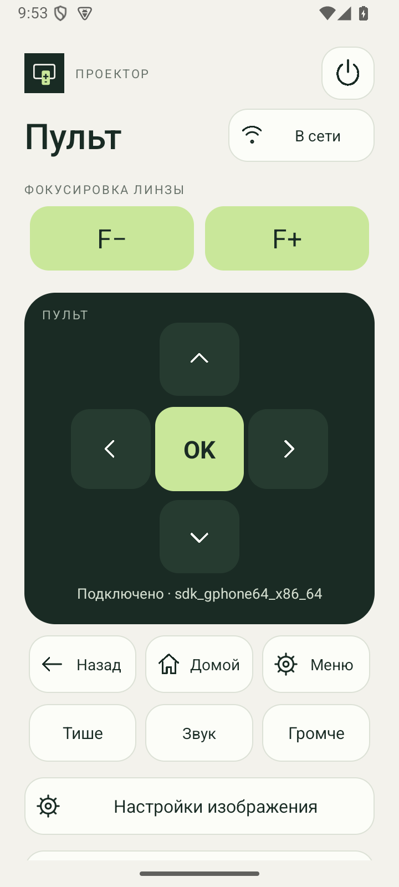
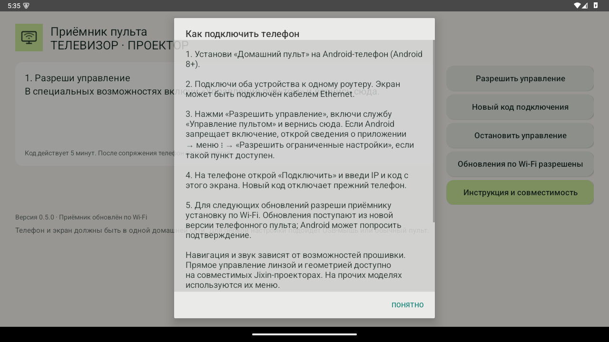

<p align="center"></p>

<h1 align="center">Home Remote</h1>
<p align="center">An Android phone remote for TVs and projectors.</p>
<p align="center"><a href="https://github.com/Karavell511/home-remote/releases/latest">Download</a> · <a href="README.ru.md">Русский</a> · <a href="https://github.com/Karavell511/home-remote/issues">Issues</a></p>
<p align="center"><a href="https://github.com/Karavell511/home-remote/actions/workflows/android.yml"></a> <a href="LICENSE"></a></p>

I lost the remote for my projector. I could get into its settings with a USB mouse, but I wanted to control it from my phone, especially the lens focus. That is how this project started.

Home Remote has two apps. One runs on your phone. The other runs on an Android TV, projector or TV box. Pair them using the code on the screen, then use the phone to navigate menus, change the volume and adjust supported projector settings.

<p align="center"></p>

## What works

Version 0.11.0 places F− / F+ at the top of the main screen. Compatible projectors are detected and remembered: a mistaken TV profile or a network failure no longer hides focus. Image settings collapse below the main controls. Mute, a power menu, narrow-screen layouts and increased-font support are included.

The phone has direction buttons, OK, back, home, menu and volume. Buttons respond when pressed, repeat when held and can give a short vibration. The screen menu can also be read on the phone, which helps when the projection is blurry or hard to see.

On compatible Jixin projectors, the app can move the focus lens, change the image size, adjust keystone and rotation, move each corner and change the projection orientation. I tested these controls on my Akenori LED 320 New with a Jixin t950s_be311 board running Android 13, including actual lens movement.

The TV profile keeps the normal remote controls and hides the projector adjustments. The receiver supports WiFi or Ethernet through the same home router. There is no account, advertising, analytics or cloud server.

## Download and connect

The [latest release](https://github.com/Karavell511/home-remote/releases/latest) contains two APKs and a ZIP with both apps and instructions.

1. Install `HomeRemote-Phone-0.11.0.apk` on your phone. It needs Android 8 or newer.
2. Install `HomeRemote-TV-Projector-0.7.1.apk` on the screen. It needs Android 7 or newer, Android TV or Google TV, with APK installation allowed.
3. Connect both devices to the same home router. In the receiver, press **Разрешить управление**, enable **Управление пультом** in Android Accessibility settings and return to the app.
4. On the phone, open the remote and press **Подключить**. It searches for the receiver automatically. Select your screen if several are found, then enter its code. You can also enter the IP address manually.

You can copy the receiver APK with a USB drive. You can also send it from the phone: open **Передать приёмник с телефона** and enter the displayed address in the screen's browser. A USB mouse can help with the initial setup if the original remote is missing.

You enter the code once. The phone remembers the receiver and reconnects when you reopen the app or WiFi comes back. If the router changes the receiver's IP, the app finds it again and checks its identity using the saved pairing key. Local discovery needs receiver 0.5.1 or newer and a router that allows devices to talk to each other.

Receiver 0.7.1 starts its connection service after Android boots or its APK is replaced. A physical Akenori reboot recovered the saved pairing without opening the receiver, using a mouse or entering a new code. Keep Accessibility enabled. Android force-stop intentionally prevents background startup until the app is opened again.

The code expires after five minutes and can only be used once. Generating a new code revokes the previous phone. One phone is paired at a time.

The app interface is currently in Russian. There is a [full Russian setup guide](docs/QUICKSTART-RU.txt) and an [English troubleshooting page](docs/TROUBLESHOOTING.md).

<details><summary>Receiver setup screen</summary><p></p>These screenshots were taken on an Android emulator.</details>

## Before installing

This is an Android receiver. Samsung Tizen and LG webOS cannot install it. An Android TV box is a separate device, so controlling the box does not automatically control the television's own settings.

Other Android projectors can use navigation and accessible settings menus. Direct focus and image controls depend on the hardware and firmware. Other Jixin models still need individual testing. Some Android apps also handle remote keys differently.

There is an optional Bluetooth keyboard mode. It needs an Android 9 or newer phone with HID Device support and a screen that accepts Bluetooth keyboards. Pairing alone does not guarantee that the keys will work. Universal infrared control and autofocus are not implemented.

## Power

The top-right power button can turn projection off and on over WiFi on compatible Jixin devices. Android and networking stay awake; sound is controlled separately. It can also open Android's shutdown/restart menu.

WiFi cannot wake the tested projector after full shutdown. An experimental infrared check is available on phones with an emitter when the receiver firmware supplies NEC mappings. Infrared power is offered only after the user confirms a successful Home probe. Neither discovered mapping worked on the tested Akenori, so cold power-on from the phone is not supported there yet. Use the device button or a compatible physical remote.

## Receiver updates

Enable **Разрешить обновления по Wi-Fi** in the receiver once. When you install a newer phone app, it can send the bundled receiver update over the home network. Some Android versions require confirmation on the screen. Updates do not come from an internet update service.

Install official updates over the existing apps to keep pairing. Android requires matching signing certificates. Checksums are included in each release.

## Local network access

The receiver uses HTTP on port 8787 with a random token after pairing. Local discovery uses UDP port 8788 and never broadcasts the pairing key or PIN. Traffic is not encrypted with TLS. Use a trusted home network and do not expose the receiver to the internet. The APK download page uses port 8085 only while that page is open.

The receiver reads accessible screen elements and performs commands from the paired phone. Press **Остановить управление** to disable the service and revoke access. More details are in [SECURITY.md](SECURITY.md).

## Build it yourself

The apps use Java and Android framework APIs. You need JDK 17 or newer, Android SDK 35 and build tools 35.0.0. Set `ANDROID_HOME` or create your own untracked `local.properties`.

```sh
./gradlew :app:assembleDebug :receiver:assembleDebug :app:lintDebug :receiver:lintDebug
python tools/test_protocols.py
```

On Windows, use `gradlew.bat`. The phone build automatically includes the matching receiver APK. Outputs are in each module's `build/outputs/apk` folder. Your own signing key will differ from the official releases. No private signing keys are included here.

See [DEVELOPMENT.md](docs/DEVELOPMENT.md) for emulator tests and implementation details. The Jixin adapter calls a fixed set of services already installed on the projector. No root or manufacturer APK download is needed to build the project.

## Contribute

Device reports are useful. Please include the model, Android version and the buttons you actually tested in a [compatibility report](https://github.com/Karavell511/home-remote/issues/new?template=device.yml). Leave out pairing codes, tokens and personal screenshots.

English UI translation and fixes for navigation on more devices are welcome. If the app helped you, a star on the repository is appreciated.

[MIT license](LICENSE). Copyright 2026 Karavell511. Gradle wrapper files keep their [upstream notices](NOTICE).
