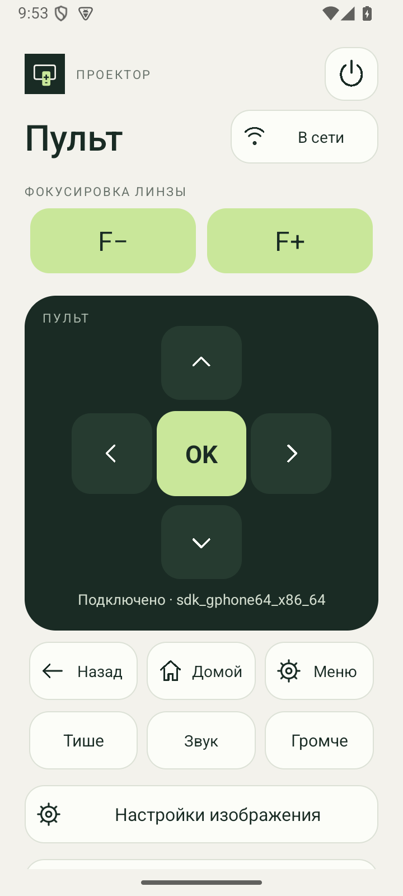
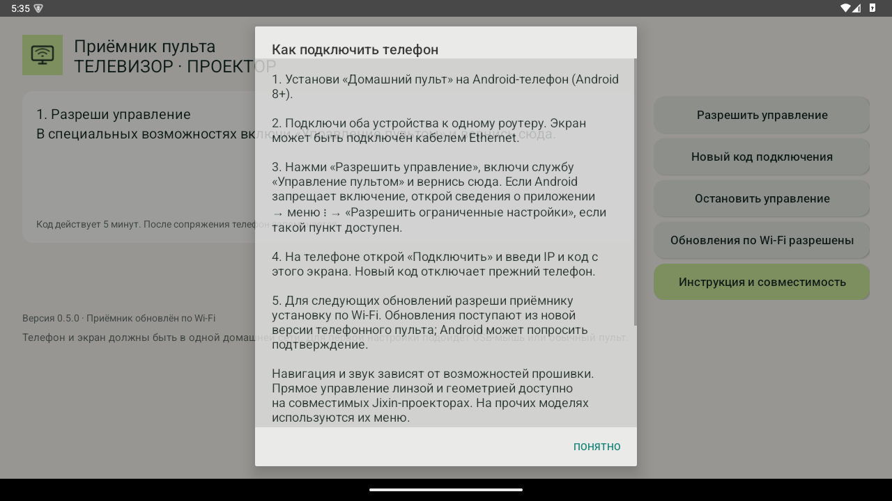

<p align="center"></p>

<h1 align="center">Home Remote</h1>
<p align="center">Пульт для Android телевизоров и проекторов на телефоне.</p>
<p align="center"><a href="https://github.com/Karavell511/home-remote/releases/latest">Скачать</a> · <a href="README.md">English</a> · <a href="https://github.com/Karavell511/home-remote/issues">Сообщить о проблеме</a></p>

Я потерял пульт от проектора. В настройки получилось зайти через USB мышь, но хотелось управлять с телефона и нормально настроить резкость линзы. С этого и началось приложение.

В Home Remote две программы. Пульт устанавливается на телефон, приёмник на телевизор, проектор или приставку с Android. Подключаете оба устройства к одному роутеру, вводите код с экрана и управляете с телефона.

<p align="center"></p>

## Что умеет

Есть стрелки, OK, назад, домой, меню и громкость. Нажатия сопровождаются вибрацией, которую можно отключить. При удержании кнопки команда повторяется. Доступные пункты меню можно читать и выбирать на телефоне. Это особенно удобно, когда изображение проектора размыто.

На совместимых проекторах Jixin доступны фокус линзы, размер изображения, трапеция, поворот, перемещение каждого угла и положение проекции. Я проверил эти функции на своём Akenori LED 320 New с платой Jixin t950s_be311 и Android 13, в том числе движение самой линзы.

В режиме телевизора остаётся обычный пульт, а настройки линзы скрыты. Приёмник может подключаться к роутеру по WiFi или Ethernet. Аккаунт не нужен. Рекламы, аналитики и облачного сервера нет.

## Скачать и подключить

В [последнем релизе](https://github.com/Karavell511/home-remote/releases/latest) лежат два APK и ZIP со всем комплектом и инструкцией.

1. Установите `HomeRemote-Phone-0.9.1.apk` на телефон с Android 8 или новее.
2. Установите `HomeRemote-TV-Projector-0.5.1.apk` на большой экран. Нужен Android 7 или новее, Android TV либо Google TV с возможностью установки APK.
3. Подключите устройства к одному роутеру. В приёмнике нажмите «Разрешить управление», включите «Управление пультом» в специальных возможностях Android и вернитесь в приложение.
4. На телефоне откройте пульт и нажмите «Подключить». Приложение само найдёт приёмник. Если устройств несколько, выберите нужное, затем введите код с его экрана. IP также можно указать вручную.

Приёмник можно перенести на флешке. Другой способ: нажать «Передать приёмник с телефона» и открыть показанный адрес в браузере телевизора или проектора. Если родного пульта нет, для первой настройки подойдёт USB мышь.

Код вводится один раз. Пульт запоминает устройство и подключается сам при повторном открытии или возвращении WiFi. Если роутер сменит IP, приложение найдёт приёмник и проверит его по сохранённому ключу. Для поиска нужен приёмник 0.5.1 или новее и сеть без изоляции устройств.

Код действует пять минут и используется один раз. Новый код отключает прежний телефон. Одновременно сохраняется один сопряжённый телефон.

[Подробная инструкция](docs/QUICKSTART-RU.txt) есть в репозитории и внутри приложения. Интерфейс пока на русском языке.

<details><summary>Экран приёмника</summary><p></p>Скриншоты сделаны на эмуляторе Android.</details>

## Что нужно знать о совместимости

APK приёмника предназначен для Android. На Samsung Tizen и LG webOS он не установится. Если к телевизору подключена Android приставка, приложение управляет самой приставкой. Это не означает доступ к настройкам телевизора.

На других Android проекторах можно пользоваться навигацией и доступными меню. Прямое управление фокусом и изображением зависит от модели и прошивки. Другие устройства Jixin ещё нужно проверять отдельно. Некоторые приложения также могут не реагировать на отдельные кнопки.

Есть дополнительный режим Bluetooth клавиатуры. Для него нужны телефон с Android 9 или новее и поддержкой HID Device, а также экран, который принимает Bluetooth клавиатуру. Само сопряжение ещё не доказывает работу кнопок. Универсальный ИК пульт, автофокус и включение полностью выключенного устройства не реализованы.

## Обновления

Один раз разрешите обновления по WiFi в приёмнике. После установки новой версии пульта на телефон он сможет передать новый приёмник по домашней сети. Иногда Android просит подтвердить установку на большом экране. Из интернета приложение обновления само не скачивает.

Официальные обновления устанавливаются поверх прежних версий с сохранением сопряжения. Подпись APK должна совпадать. Контрольные суммы приложены к релизу.

## Доступ по домашней сети

Приёмник использует HTTP на порту 8787 и случайный токен после сопряжения. Поиск работает через UDP порт 8788 и не рассылает код или ключ подключения. Трафик управления не шифруется TLS, поэтому нужна доверенная домашняя сеть. Открывать порты в интернет не следует. Страница передачи APK использует порт 8085, пока она открыта на телефоне.

Служба читает доступные элементы экрана и выполняет команды сопряжённого телефона. Кнопка «Остановить управление» выключает службу и отзывает доступ. Подробности есть в [SECURITY.md](SECURITY.md).

## Собрать самостоятельно

Нужны JDK 17 или новее, Android SDK 35 и Build Tools 35.0.0. Укажите `ANDROID_HOME` либо свой `local.properties`, затем выполните:

```sh
./gradlew :app:assembleDebug :receiver:assembleDebug :app:lintDebug :receiver:lintDebug
python tools/test_protocols.py
```

В Windows используйте `gradlew.bat`. Приёмник автоматически вкладывается в приложение телефона. Ключей подписи в репозитории нет, поэтому самостоятельная сборка не сможет заменить официальный APK с другой подписью. Подробнее о коде и тестах в [DEVELOPMENT.md](docs/DEVELOPMENT.md).

## Помочь проекту

Буду рад отчётам о других устройствах. Укажите модель, версию Android и конкретные кнопки, которые проверили, в [отчёте о совместимости](https://github.com/Karavell511/home-remote/issues/new?template=device.yml). Коды подключения, токены и личные данные публиковать не нужно.

Также пригодятся перевод интерфейса на английский и исправления навигации. Если приложение выручило, поставьте звезду репозиторию.

Лицензия [MIT](LICENSE). Авторские права: Karavell511, 2026. Файлы Gradle сохраняют [лицензию разработчиков Gradle](NOTICE).
